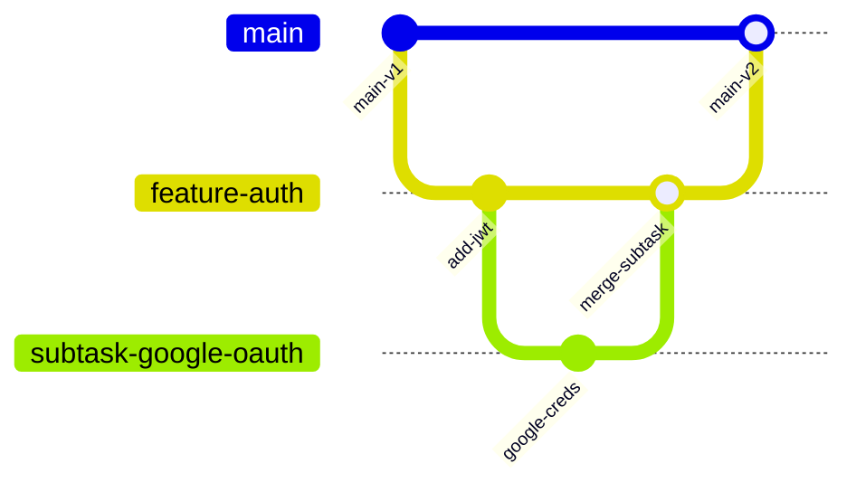
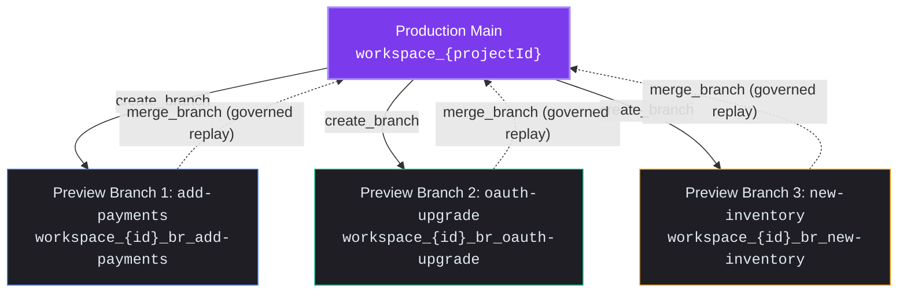

# Backenly Cloud: Comprehensive Product Audit & Bug Report

**Date:** November 20, 2026  
**Target Environment:** Backenly Cloud ([https://backenly.com](https://backenly.com))  
**Audience:** Backenly Engineering & Product Team  
**Author:** Testing & Evaluation Session

---

## Executive Summary

This report documents critical observations, edge-case bugs, and product improvements discovered during end-to-end testing of the **Backenly Cloud** platform. 

Key findings include a **critical regex validation blocker** preventing GitHub OAuth setup, an **infinite autonomy self-healing loop** for Google redirect URIs, **MAU metric inflation**, and UX gaps across deployment states, branch navigation, and API documentation.

---

## 1. Branching Architecture: Flat Hierarchy vs. Git

### Observation
In Git, branching is arbitrary and recursive (`main → feature → sub-task`). A developer can create a branch off an unmerged feature branch. 

In Backenly, **every preview branch is strictly 1-level, branching directly off `main`** (`workspace_{projectId}`). You cannot cut a branch from an existing, unmerged preview branch.

### Visual Branch Map Comparison

#### Git Recursive Branching


#### Backenly Flat Schema Branching (Current Implementation)


### Recommendation
1. **Interactive Branch Map**: Display a visual topology diagram in the dashboard so developers instantly see all active preview branches connected to `main` with their status, diff count, and preview URLs.
   - **Live Interactive Demo**: Available to test and share at [`https://sara-puerto-mid-triple.trycloudflare.com/preview/branch-map`](https://sara-puerto-mid-triple.trycloudflare.com/preview/branch-map).
2. **Clear UI Tooltip**: Clarify in the "Create Branch" dialog that branches are direct structural snapshots of production `main`.

---

## 2. Deployment & Publishing UX

### Issue 2.1: Publish Button Not Dimmed When No Changes Exist
- **Current Behavior**: The **Publish** button in the Deploy tab appears fully active even when the project has zero pending schema or configuration changes.
- **Expected Behavior**: If the working state is identical to the published release, the **Publish** button should be **disabled / dimmed** with a tooltip: *"All changes published. Working state matches production."*

### Issue 2.2: Missing High-Visibility "Unpublished Changes" Indicator
- **Current Behavior**: When a developer creates a table, edits an RLS policy, or changes an API setting, there is no persistent or eye-catching warning indicating that live traffic is still running on the previous published snapshot.
- **Expected Behavior**: Add a prominent status chip or banner in the top navigation bar (e.g., `[ ⚠️ 3 Unpublished Changes — Click to Publish ]`) so developers immediately notice when their working draft is ahead of production.

---

## 3. Authentication & OAuth Integration Flaws

### Issue 3.1: GitHub OAuth Client Secret Blocked as "AWS Secret Key" (CRITICAL BUG)
- **Bug Description**: When entering a standard GitHub OAuth App Client Secret into the integration configuration, the submission is rejected with the error:
  > *"This value looks like a Possible AWS secret access key (40-char base64). Storing private keys, database URLs, or JWT tokens as integration keys is not allowed — this could expose your infrastructure. Please provide only a service API key (e.g. sk_live_..., re_..., key_...)."*
- **Root Cause Identified**: In `lib/ai/api-key-detector.ts` (line 315), the `aws_secret_key` detector uses a naive 40-character base64 regex:
  ```ts
  if (/^[A-Za-z0-9/+=]{40}$/.test(trimmed)) return true
  ```
  Standard GitHub OAuth client secrets are exactly 40 alphanumeric characters. Because of this over-broad check, **valid GitHub OAuth client secrets are falsely flagged as AWS root credentials and blocked**.
- **Fix Required**: Whitelist GitHub OAuth client secrets or require AWS key matching to accompany an AWS access key prefix (`AKIA`, `ASIA`, `ABIA`, `ACCA`).

### Issue 3.2: Autonomy Google OAuth Redirect URI Fix Loop (LOGIC BUG)
- **Bug Description**: After configuring Google OAuth, Autonomy generates the following finding:
  > *"An OAuth provider (google) has no redirect URI configured. Changing redirect URIs requires confirmation from the identity provider. AI hypothesis, not verified... Choose 'Approve & fix' so the platform adds the correct redirect URI..."*
  When the user clicks **Approve & fix**, the system displays:
  > *"The fix ran but the issue is still present on re-check, so it was not recorded as fixed. Nothing was lost — the finding stays in your queue with the details."*
- **Root Cause Identified**: 
  - `lib/core/drift-detector.ts` checks: `if (!cfg.redirectUri) findings.push({ type: 'oauth_redirect_uri_missing' })`.
  - In `lib/ai/minimal-executor.ts` (`executeFixAuth`), the repair action for OAuth providers only checks if the configuration row exists, but **does not actually populate or compute the canonical redirect URI** (`https://backenly.com/api/v1/{projectId}/auth/callback/google`).
  - The verification step re-checks the database, sees `redirectUri` is still `null`, and refuses to clear the finding, trapping the user in an endless queue cycle.
- **Fix Required**: `executeFixAuth` must write the canonical redirect URI into `WorkspaceOAuthConfig.redirectUri` when the fix runs.

### Issue 3.3: Inadequate Setup Instructions for Google & Facebook Login
- **Google Sign-In**: Missing clear step-by-step documentation showing the developer their exact Authorized JavaScript Origins and Authorized Redirect URIs to paste into the Google Cloud Console.
- **Facebook Login**: Instructions are outdated and the redirection callback frequently drops query parameters or fails silently upon return. Needs clear Meta Developer App setup guidance (Consumer app type, Valid OAuth Redirect URIs, client token requirements).

---

## 4. API & Endpoints Documentation

### Issue 4.1: Missing Request & Response Schema Models
- **Current Behavior**: The Endpoints / API builder lists route paths and methods, but does not render the expected JSON request body schema or sample response envelope.
- **Proposed Enhancement**: Display expandable **Request Payload** and **Response Model** cards (JSON schema / TypeScript interfaces) next to each endpoint for instant frontend integration reference.

### Issue 4.2: Functions Tab Only Shows "POST" Endpoints
- **Current Behavior**: Under the Functions tab, all endpoints are statically badged as `POST`.
- **Proposed Enhancement**: Clarify whether Serverless Functions are strictly webhook/mutation handlers (`POST` only), or allow developers to expose `GET` endpoints for idempotent AI/compute routines with corresponding badges (`GET`, `POST`, `PUT`, `DELETE`).

---

## 5. Branch Management & History Visibility

### Issue 5.1: Change History Restricted to `main`
- **Current Behavior**: The History tab only reflects changes made to the `main` schema. Changes made within active preview branches are invisible until merged.
- **Proposed Enhancement**: Add a **Branch Selector Dropdown** in the History tab (defaulting to `main`), allowing developers to inspect the chronological migration log and audit trail of any active preview branch (`workspace_branch_migrations`).

---

## 6. Analytics, Usage & Regional Billing

### Issue 6.1: Monthly Active Users (MAU) Calculation Discrepancy
- **Current Behavior**: The Usage tab displays **27 Monthly Active Users**, while the actual project database only contains **3 to 4 registered end-users**.
- **Root Cause**: The MAU meter is likely tracking anonymous session tokens, pre-flight health probes, or platform API calls instead of distinct end-user IDs in `workspace_{projectId}.users`.
- **Proposed Enhancement**: Filter MAU calculation strictly by distinct `user_id` from authenticated end-user requests, excluding platform admins and anonymous requests.

### Issue 6.2: Global Currency Locked to USD ($)
- **Current Behavior**: All pricing, usage costs, and credit balances are displayed exclusively in US Dollars (`$`).
- **Proposed Enhancement**: Support currency localization (e.g., INR `₹`, EUR `€`, GBP `£`) based on the billing country or provide an estimated regional conversion toggle.

---

## 7. Action Matrix for Engineering Team

| Priority | Issue | Component / File | Recommended Action |
|:---:|---|---|---|
| **P0** | GitHub client secret blocked by AWS regex | `lib/ai/api-key-detector.ts` | Remove standalone 40-char base64 check for OAuth secrets |
| **P0** | Autonomy Google redirect URI fix loop | `lib/ai/minimal-executor.ts` | Populate `redirectUri` in `executeFixAuth` before re-check |
| **P1** | Dim Publish button when 0 changes | `app/projects/[id]/deploy/page.tsx` | Add `hasPendingChanges` boolean check to disable state |
| **P1** | "Unpublished Changes" top banner | `components/inspector/` | Add persistent visual alert when working draft != published |
| **P1** | MAU metric discrepancy (27 vs 3) | `lib/billing/usage.ts` | Count distinct end-user IDs instead of raw request sessions |
| **P2** | Show Request/Response models in API viewer | `components/api-builder/` | Render schema models & JSON examples per endpoint |
| **P2** | History branch selector | `app/projects/[id]/history/` | Add branch switcher dropdown to inspect branch migration logs |
| **P2** | Google & Facebook OAuth instructions | `app/projects/[id]/auth/` | Display copyable redirect URIs and step-by-step guides |
| **P3** | Multi-currency / localized display | `lib/billing/` | Detect locale or allow currency toggle (USD / INR / EUR) |
| **P3** | Function endpoint verb visibility | `components/functions/` | Support or label HTTP method support beyond POST |
